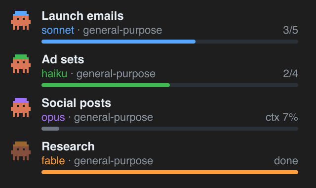
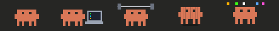

# claude-mods

Two [Claude Code mods](https://code.claude.com/docs/en/plugins/mods/overview): a workbench bar for the prompt, and guards that stop common mistakes before they happen.


## Install

At the prompt of a Claude Code terminal session:

```
/plugin install workbench-bar --marketplace henrikogaard/claude-mods
/plugin install guards --marketplace henrikogaard/claude-mods
```

From a shell:

```bash
claude plugin install workbench-bar --marketplace henrikogaard/claude-mods
```

In the desktop app, where `/plugin` does not run: click **+** next to the prompt box, then **Plugins**, **Add marketplace** with `henrikogaard/claude-mods`, then **Add plugin**.

To run a mod from a clone instead, point Claude Code at its folder: `claude --plugin-dir ./plugins/workbench-bar`, or list the folders in `CLAUDE_CODE_PLUGIN_DIRS` under `env` in `~/.claude/settings.json`.

## workbench-bar

A bar above the prompt that shows what's going on, and a details panel behind it.

**In the bar (desktop app)**

| Item | What it shows |
| :- | :- |
| Clawd | Rests and blinks; codes on a laptop, lifts weights or bounces while Claude works; throws a party when a long turn ends |
| ☰ / ⚡ | Switches the app's sidebar between grouping by project and by activity |
| 🔇 / 🔈 | Sound on or off for the done chime (off by default; remembered) |
| ◆ ABC-26 | The Linear issue named in the branch (`feat/abc-26-…`), as a link |
| 🔔 | Pull requests waiting for your review |
| PR #42 ● ✓ | This branch's pull request, its CI light (green, amber blinking, red) and ✓ when it's merge-ready |
| 🤖 2 · 5/9 | Running subagents and the steps they've reported, with a small progress bar |
| 🐙 3 · 7 · ◆ 22 | Open PRs and issues on GitHub, open issues on the matching Linear team |
| ⧗ 1 | Other threads working right now |
| ctx / 5h / wk | This thread's context, and the plan's 5-hour and weekly usage, as dithered pixel meters. `⚠ ~1h20` when you'll run out before the reset |

A new thread opens with a few seconds of falling orange letters. In a terminal the bar shows the meters only.

**The details panel** opens when you click an item. ⟳ (or `r`) fetches everything again.

- **Git:** branch, the delivery checklist (Implemented locally → Pushed → Ready for review → Merge-ready → Merged) with the next step, the PR's checks, 🛠 **Fix CI** and ↻ **re-run** a failed check.
- **Agents:** cost, today's cost across threads, agent tokens and time; a card per subagent with a Clawd in a hat by model, steps or context fill, tokens, estimated cost and time.

  
- **GitHub:** review requests, PRs (author, branch, +/−, files, review state, CI) and issues (labels, comments, age), in foldable groups.
- **Linear:** issues grouped by status (Backlog folded), with priority, assignee and age; filters for All, Mine, Urgent and In progress.
- **Threads:** the other threads on this machine, working or waiting.

Every PR and issue title is a link; ⧉ opens it in Claude's own browser pane and ▶ starts a new thread for an issue.



**Subagent steps.** The mod adds a `step` tool and one line to each subagent's brief asking it to report `done` and `total`. A subagent that doesn't report shows its context fill in grey. Costs are estimates from token counts and list prices, not a bill.

**Needs:** the [GitHub CLI](https://cli.github.com) signed in, for PRs, issues and CI. A connected Linear connector, for Linear: the team is matched to the repository's name (repository `acmeapp` → team `Acme`). If `/mcp` lists your Linear connector under an id rather than `claude.ai Linear`, set the `linearServer` option to that name. The sidebar toggle and the threads list use the desktop app's own tools, so they work only there.

**Options** (`/config`, or `pluginConfigs` in `~/.claude/settings.json`): `sound` (default off) and `linearServer`.

## guards

Three checks that run before a tool does, and refuse with a reason Claude can act on:

| Guard | Refuses |
| :- | :- |
| Attribution | `git commit` and `gh pr create`/`edit` whose text credits an AI (`Co-Authored-By: Claude`, "Generated with Claude Code") |
| Secrets | Commands and file writes holding a key or token (Anthropic, OpenAI, GitHub, AWS, Slack, Google, private keys). 1Password `op://` references pass |
| Branch | File edits inside a git repository checked out on `main` or `master`. Files under `~/.claude/` are exempt |

Each guard has an option of the same name (`attribution`, `secrets`, `branch`) to switch it off.

## Develop

```bash
claude plugin validate plugins/workbench-bar
claude plugin test plugins/workbench-bar
```

## License

[MIT](LICENSE)
